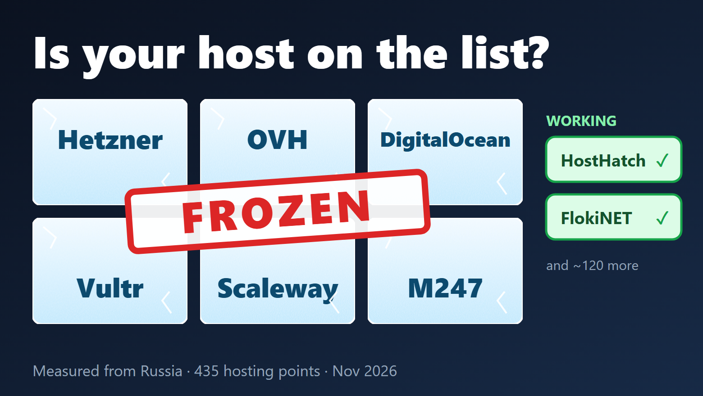
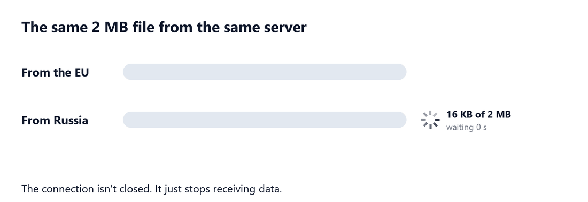
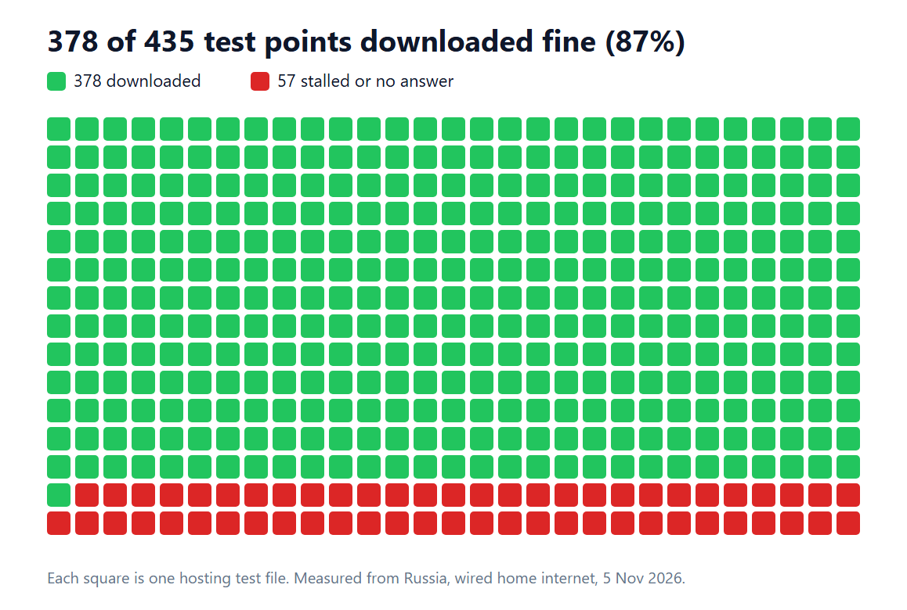
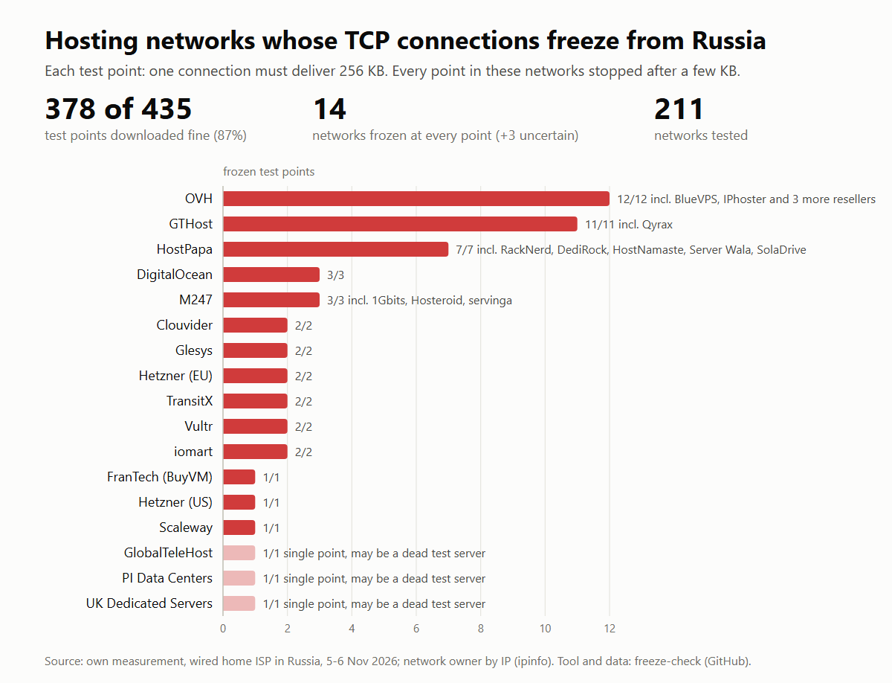
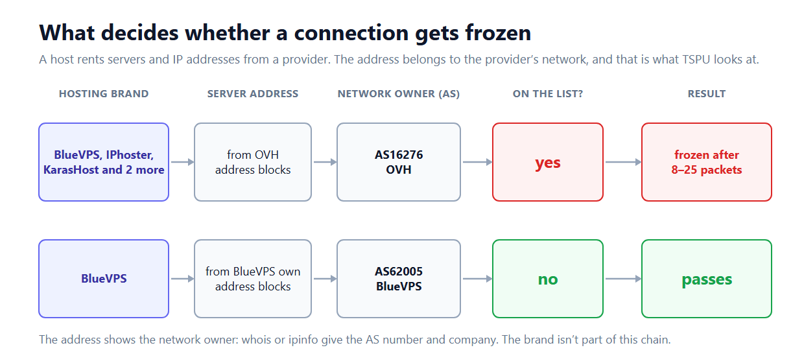
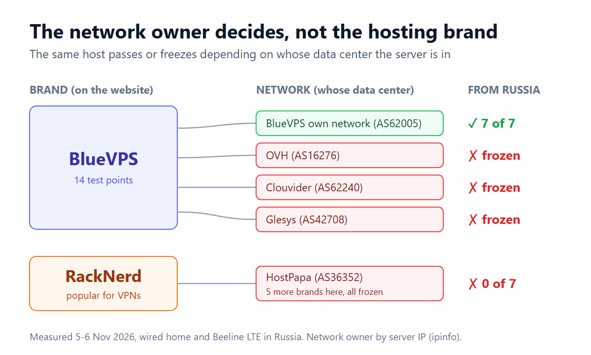
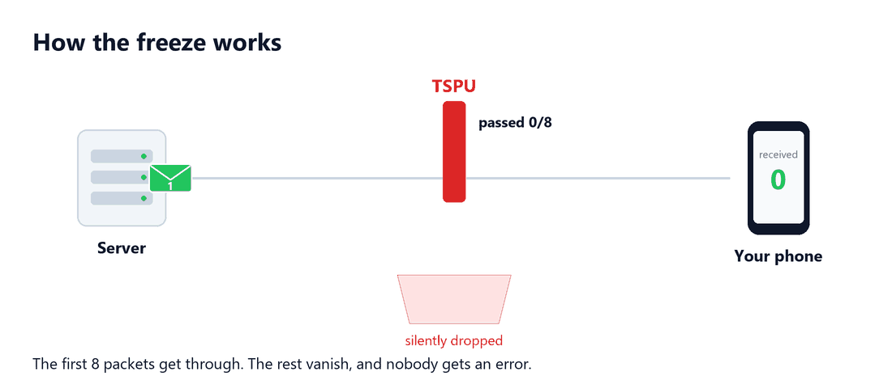
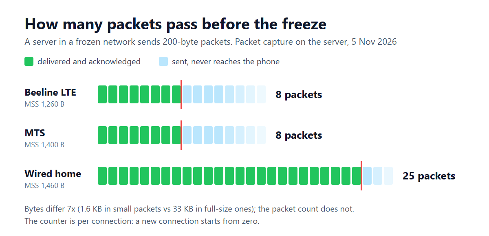

# Russia doesn't block sites, it freezes whole networks. I tested 435 hosting locations

My VPN server ran on Hetzner, and from Russia it behaved oddly: some connections flew, others hung
until they timed out. I started digging and ended up testing 435 foreign hosting locations. Most
of them work. What gets frozen is whole networks, along with everyone renting space inside them.
Below: who exactly, how it works at the packet level, and how to check your own server in 30
seconds.



## How it started

The server offered two ways to connect. AmneziaWG (a WireGuard fork) was fast. Reality, a TCP-based
protocol, on the same server never connected at all: the connection opened and just hung.

My first guess was that my IP had been blacklisted. I put a 2 MB file on the server and opened it
from Russia with the VPN off. The download stalled within the first few kilobytes, every time at
the same point. From the EU the same file arrived in a quarter of a second.



Then I tried Hetzner's own speed-test files in Finland and Germany. They stalled the same way, so
my IP had nothing to do with it. OVH, Vultr and Scaleway test files did too, so Hetzner wasn't
special either.

## Who gets frozen

To see the scale, I collected public test files from hosting providers, mostly from the
looking.house catalog, and wrote a script that opens one connection to each and tries to download
256 KB. I ran the whole list from the EU first to drop dead points. 435 points at 154 companies
remained.

Then the same list from Russia. On wired home internet 87% of the points downloaded. The rest
stalled at almost the same size, about 16 KB, across different companies and continents. Mobile
Beeline showed the same picture, and on a smaller sample so did MTS. The operator doesn't matter:
it's one rule for the whole country.



The stalled points cluster into 14 networks frozen at every point:



| Network | Frozen points | Who else sits in it |
|---|---|---|
| OVH (France, Canada, US) | 12 of 12 | BlueVPS, IPhoster, KarasHost, SadeemRDP, ThomasHost |
| GTHost | 11 of 11 | Qyrax |
| HostPapa | 7 of 7 | RackNerd, DediRock, HostNamaste, Server Wala, SolaDrive |
| DigitalOcean | 3 of 3 | London, US, Australia |
| M247 | 3 of 3 | 1Gbits, Hosteroid, servinga |
| Hetzner (incl. US and Singapore) | all | Packetra |
| Vultr, Scaleway, BuyVM, Clouvider, Glesys, iomart, TransitX | all | |

Three more networks failed at their only tested point. That could be the freeze or just a dead test
server, so I don't count them.

Passing, for example: HostHatch, FlokiNET, Psychz, Shock Hosting, Free Range Cloud, AltusHost,
Kuroit, Virtua, SpeedyPage, Time4VPS, Serverius, LiteServer and Google Cloud, about 120 companies in
total. I'm not recommending any of them; it's the result as of the test date.

## The network matters, not the hosting brand

At first the results looked random. Some BlueVPS points passed and others didn't. It all made sense
once I looked at whose network each point sits in.

Many small hosts don't run their own networks. They rent racks and IP addresses from a large
provider, and the server's address stays that provider's address: it is announced on the internet
by the provider's autonomous system (AS). Judging by the results, that is exactly what TSPU decides
on: whether the destination address belongs to a network on its list. The hosting brand isn't part
of that chain.



The owner is easy to check: whois or ipinfo on the server's IP shows the AS number and company.
BlueVPS in its own network passed all 7 points. The same BlueVPS inside OVH, Clouvider and Glesys
networks is frozen. RackNerd, which many treat as a separate budget host, sits in HostPapa's network
and is frozen with it.



Location doesn't help either. Hetzner's US and Singapore networks have their own AS numbers and are
frozen like the European ones. OVH is frozen in France, Canada and the US. It looks like whole
companies go on the list, with all their networks.

## How the freeze works

To find out what is counted, I put a server in a frozen network and recorded every packet in and
out of it, while a phone in Russia ran several tests, including a stream of tiny 200-byte packets.



That test gave the answer. On wired home internet the tiny packets stopped after 4.8 KB and
full-size ones after 33 KB. Seven times fewer bytes, about 25 packets both times. On mobile Beeline
and MTS the limit is lower, about 8 packets.



What follows from it:

- packets are counted, not bytes; the well-known "16 KB" is just 25 full-size packets;
- the counter is per connection: thirty short connections all went through, while one long
  connection carried only the first chunks;
- it freezes both ways: after the limit, the phone's requests stop reaching the server too;
- the connection isn't reset, it just hangs, so the client doesn't fail fast and waits for a
  timeout;
- on mobile, 8 packets aren't even enough to finish a TLS handshake with a certificate chain, so
  HTTPS and Reality get nothing. That's why my Reality never connected.

AmneziaWG kept working because the freeze only affects TCP. WireGuard and AmneziaWG run over UDP,
which the freeze doesn't touch, at least for now.

## Why these networks

Nobody has published the list, but there is a pattern: these are networks with a lot of VPN
servers. Hetzner and DigitalOcean are cheap, billed hourly, and
[widely used by Russians for private VPNs](https://ppc.land/russian-isps-throttle-cloudflare-traffic-to-16kb/).
M247 [sells servers for VPNs](https://www.m247global.com/vpn-servers) itself, and addresses in its
network [are identified](https://www.netify.ai/resources/platforms/m247) as CyberGhost, Hotspot
Shield and other commercial VPN endpoints.

But plenty of hosts popular with VPN operators pass, HostHatch and FlokiNET among them. It looks
like the biggest ones get frozen, where one rule hits the most servers at once. That's a guess, and
better explanations are welcome.

## Who is doing it

I can't see the equipment, but everything points to TSPU, the filtering system that Russia's
"sovereign internet" law, in force since November 2019, puts at every operator; Roskomnadzor sets
its rules. Three different operators behave identically down to the packet, which only happens when
the rule comes from above. And it isn't an IP block: with one, the connection never opens at all.

[Cloudflare described](https://blog.cloudflare.com/russian-internet-users-are-unable-to-access-the-open-internet/)
the same 16 KB limit back in June 2025 and said it was applied by Russian ISPs themselves,
naming Rostelecom, MegaFon, Vimpelcom (Beeline), MTS and MGTS.

Interestingly, Cloudflare itself passes now. I tested ordinary Cloudflare-served sites, including
cloudflare.com, cdnjs, unpkg and jsDelivr, on wired and mobile: all 36 attempts went through. The
list changes, and sometimes things get removed. Hetzner, DigitalOcean and OVH, affected at the same
time, are still frozen.

## If your server is frozen

1. Check who owns the network: whois or ipinfo on the IP. If it's OVH, M247, HostPapa or Hetzner,
   the name on the hosting website no longer matters.
2. Confirm it's the freeze: from Russia with the VPN off the download stalls, from abroad it works.
3. If it's urgent, bring up WireGuard or AmneziaWG on the same server. It's a stopgap.
4. Don't bother with a new IP from the same provider or another port: the new IP is in the same
   network, and the port doesn't matter.
5. Move to a network that passes and pick it by measurement; reviews won't tell you. With hourly
   billing you can test a server for cents before moving.
6. Keep a spare server in another company's network: the list changes.

## Check it yourself

The script and target list are in this repository. They need only `bash` and `curl`, run on Linux,
macOS and Git Bash on Windows, upload nothing, and the results contain no IP address.

```bash
mkdir freeze-check && cd freeze-check
curl -fsSLO https://raw.githubusercontent.com/MarkSinD/freeze-check/main/freeze-check.sh
curl -fsSLO https://raw.githubusercontent.com/MarkSinD/freeze-check/main/targets.tsv
```

The script is short; read it before running. Then, from Russia:

```bash
bash freeze-check.sh scan --quick --wait
```

`--wait` lets you start it and turn the VPN off afterwards; it waits for a Russian address. If you
are outside Russia, `bash freeze-check.sh owner YOUR_SERVER_IP` tells you who owns your server's
network and whether that network was frozen in this test.

<details>
<summary><b>Methodology in detail</b></summary>

**Targets.** 452 public test files at 154 hosting companies: mostly looking.house points, plus 16
of my own (providers' speed-test servers, Cloudflare, Google Cloud Storage).

**Control.** The whole list ran first from a VPS in Latvia on 5 November 2026. Points that failed
there were dropped as dead. 435 points in 211 networks remained.

**One point.** `curl` requests the first 256 KB over a single connection. Limits: 8 s to open the
connection including TLS, abort after 6 s without data, 25 s per point (40 s in the public tool, so a
slow mobile link isn't mistaken for a freeze). The certificate isn't checked: only delivery is
measured. 16 points in parallel, 2-3 minutes for the list.

**Verdict.** 256 KB or the whole file arrived: pass. Stopped between 1 byte and 64 KB: frozen. More
than 64 KB but too slow: slow. Nothing: empty.

**Network owner.** AS number and owner by each point's IP via ipinfo. A network counts as frozen if
none of its points passed.

**Runs from Russia.** Wired home internet: 5 November, 22:04 UTC; of 435 points 378 passed, 52
stalled, 5 empty. Beeline LTE via phone hotspot: 6 November, 11:17 UTC; matched the wired result on
415 of 435 points. MTS checked by hand on 17 points. Before each run the script checks the address is
Russian.

**First measurement.** The 2 MB file on my server: on Beeline it stopped at 9,984 bytes over HTTP and
4,096 over HTTPS, on wired home at 33,304 and 24,576. From the EU it arrived in 0.25 s, six of six.

**Mechanics.** A temporary server in Hetzner's network, a plain HTTP page on ports 8080, 50000, 2053
and 80, `tcpdump` recording headers only. Android phone, Chrome, VPN off. Tests: a 2 MB stream; 30
chunks of 3,000 bytes, each on a new connection; the same chunks on one connection; 200-byte packets
every 30 ms; a 1 MB upload (on wired home the server got zero bytes of the body); other ports. MSS:
Beeline 1,260 bytes, MTS 1,400, wired 1,460. No RST after the freeze on any network.

**Cloudflare and CDNs.** Seven URLs, three tries each, 6 November, wired home and Beeline LTE.

**Raw data.** All runs, anonymized, no IP addresses: [data/2026-11](data/2026-11).

</details>

<details>
<summary><b>Oddities I can't explain</b></summary>

Hivelocity (US) stalled at the same 16 KB on Beeline but passed on wired home. All five points in
Ukrainian networks failed to connect on Beeline but worked on wired home. The second looks like a
separate block of Ukrainian networks, unrelated to the hosting freeze. Data from other operators
would help.

</details>

## Limitations

Measured on 5-6 November 2026 by one person on two connections in one city. A provider's test files
may sit in a different subnet from its VPS. AWS and Azure are in the list for the next run; Oracle,
Contabo and Linode had no working public test files. I'll repeat the scan and update the numbers.

## Your turn

If you're in Russia, run the script and share the result through the
[GitHub form](https://github.com/MarkSinD/freeze-check/issues/new?template=freeze-check-result.yml):
operator, region, date and output, no IP. Tele2, MegaFon, Rostelecom and other regions are
especially interesting. If you host something for Russian users, check whose network your server
is in. A Russian version of this write-up is on Habr.
